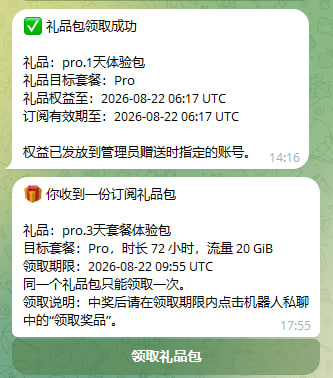
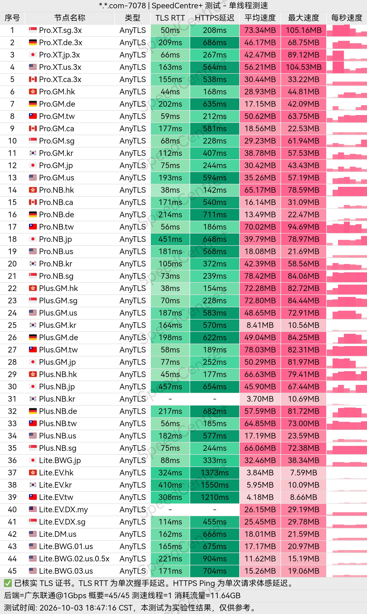
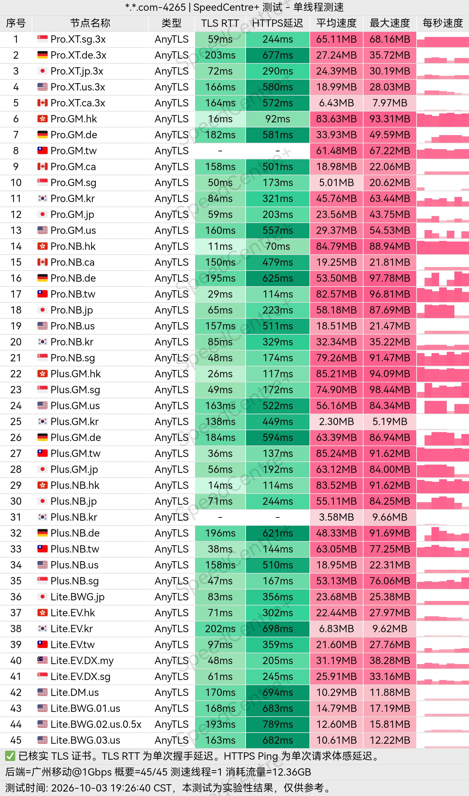
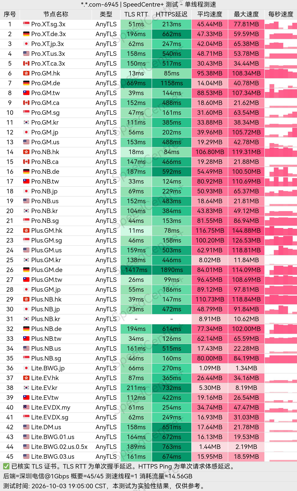
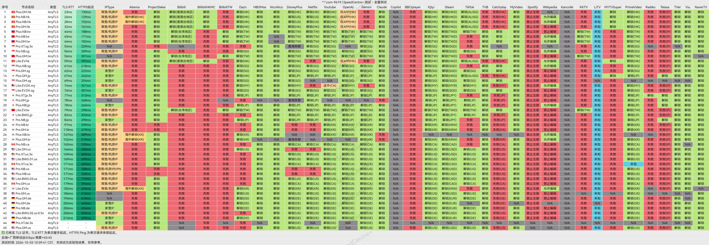
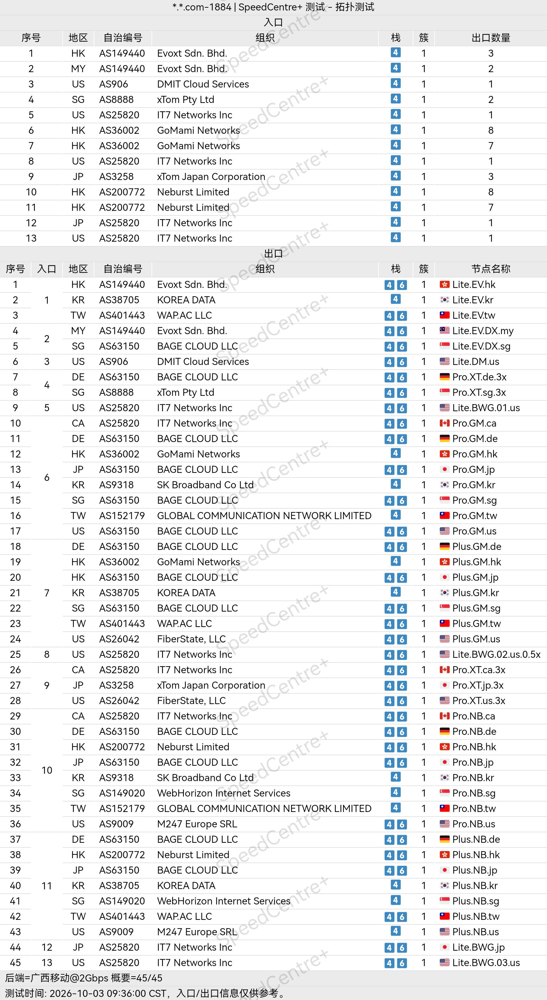

🇨🇳 [中文](README.md) | 🇺🇸 English | 🇷🇺 [Русский](README_RU.md) | 🇮🇷 [فارسی](README_FA.md)

# Jeeyio VPN Official Website (Updated November 8, 2026)

Jeeyio VPN Official Website<br>
Official Website: [jeeyio.com](https://to.iix.im/jy01)<br>
Telegram Registration Bot: [https://t.me/Jeeyio_bot](https://t.me/Jeeyio_bot)<br>

## Invitation Code

`When registering through the Telegram bot, you must manually enter the invitation code.`<br>

```bash
8HSMGF
```

<br>

## Promo Code / Discount Code

`None`

## Overview

Jeeyio VPN is a proxy service designed for international internet access, supporting modern protocols such as VLESS and AnyTLS.

The service focuses on simplicity and practicality, making it suitable for everyday web browsing, social media, streaming entertainment, studying, and remote work.

Jeeyio aims to provide users with a smoother and more flexible experience when connecting to overseas internet resources.

## Advantages

Jeeyio VPN stands out for its modern protocol support, flexible configuration options, and balance between speed and stability.

The service supports VLESS and AnyTLS protocols, making it compatible with various popular VPN and proxy clients across multiple devices.

Its convenient connection management and server switching features make Jeeyio suitable for users who value network performance, ease of use, and compatibility across different applications.

## Plans & Pricing

| Plan | Tier | Monthly Price | Monthly Data | Simultaneous IPs | Concurrent Connections | Maximum Speed | Self-Hosting Support | Key Features |
|---|---|---:|---:|---:|---|---|---|---|
| Standard Plan · Base | L1 | ¥12.00/month | 60 GB | 3 | Unlimited | Unlimited | Yes | Provides low-traffic-multiplier nodes, helps maintain continuous connectivity, and includes essential core benefits |
| Standard Plan · Plus | L2 | ¥30.00/month | 150 GB | 5 | Unlimited | Unlimited | Yes | Designed for smooth web browsing with additional entry points; compared with Base: +90 GB data and +2 simultaneous IPs |
| Standard Plan · Pro | L3 | ¥48.00/month | 240 GB | 10 | Unlimited | Unlimited | Yes | Supports streaming service unblocking and smooth access, with additional exclusive entry points; compared with Plus: +90 GB data and +5 simultaneous IPs |

## 📊 Real-World Performance Tests & Analysis

#### 1.1 China Unicom Evening Peak-Hour Speed Test

<br>

#### 1.2 China Telecom Evening Peak-Hour Speed Test

<br>

#### 1.3 China Mobile Evening Peak-Hour Speed Test

<br>

#### 2. Streaming Service Unblocking Report

<br>

#### 3. Exit Node and Network Entry Analysis

<br>
