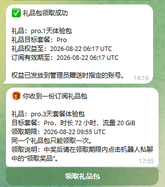
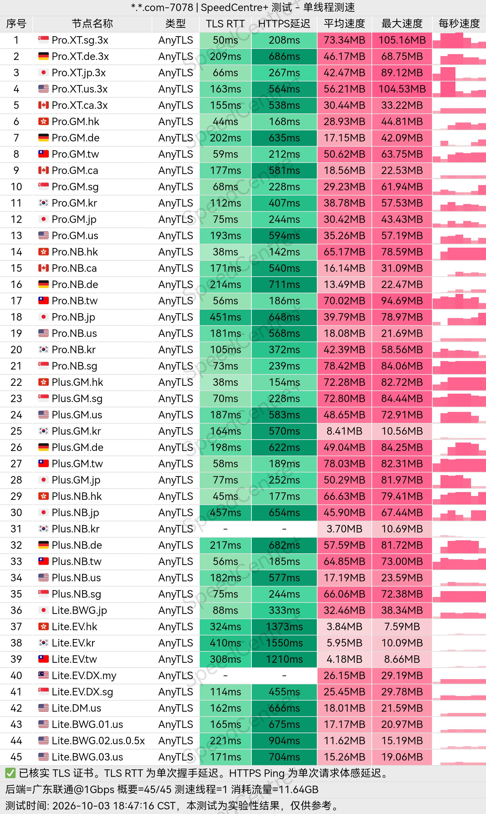
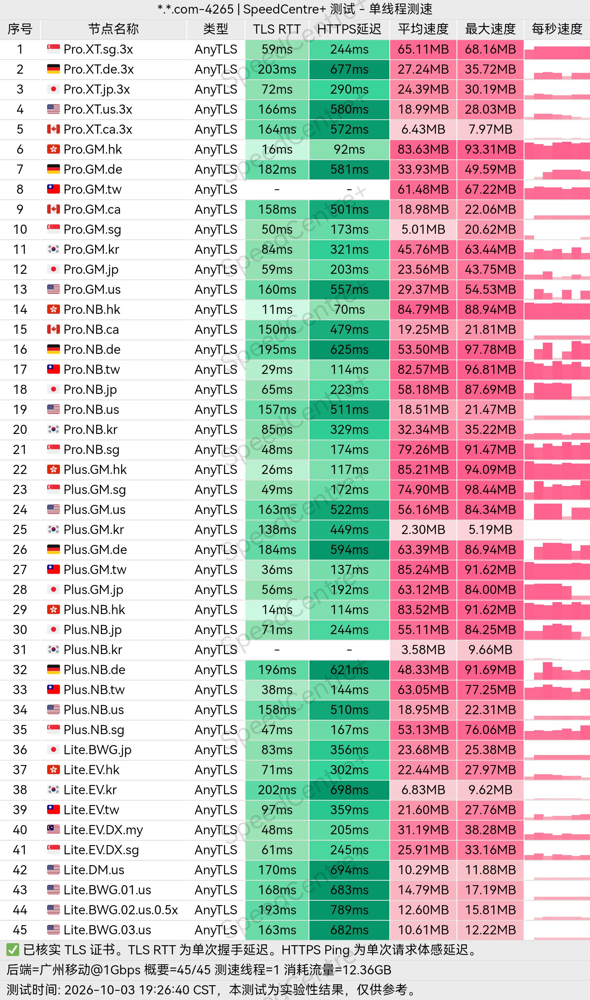
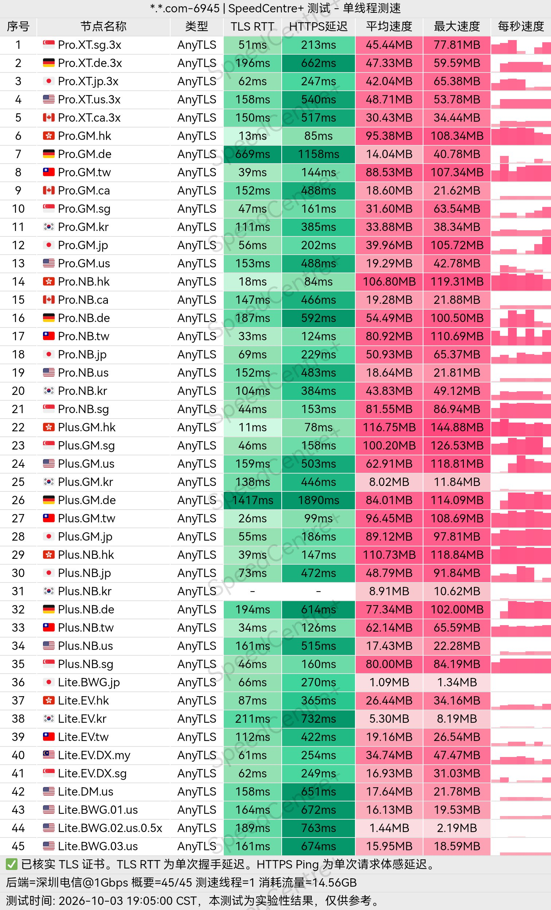
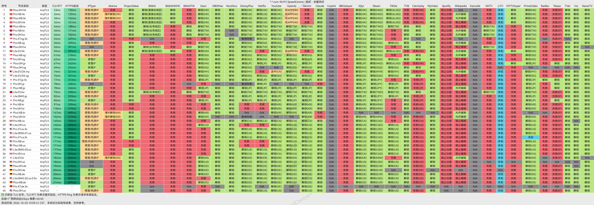
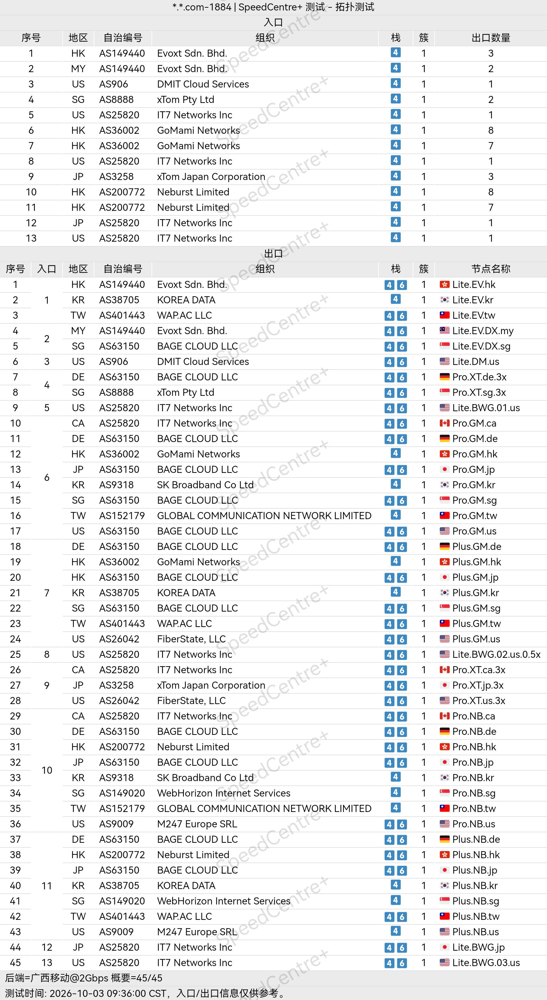

 🇨🇳 [中文](README.md) | 🇺🇸 [English](README_EN.md) | 🇷🇺 [Русский](README_RU.md) | 🇮🇷 فارسی

# آدرس رسمی VPN جی‌ییو (Jeeyio) - به‌روزرسانی ۲ نوامبر ۲۰۲۶

وب‌سایت رسمی VPN جی‌ییو (Jeeyio)<br>
آدرس رسمی: [jeeyio.com](https://to.iix.im/jy01)<br>
ربات تلگرام برای ثبت‌نام: [https://t.me/Jeeyio_bot](https://t.me/Jeeyio_bot)<br>

## کد دعوت

`هنگام ثبت‌نام از طریق ربات تلگرام، باید کد دعوت را به‌صورت دستی وارد کنید.`<br>

```bash
8HSMGF
```

<br>

## کد تخفیف

`ندارد`

## معرفی

Jeeyio VPN یک سرویس پروکسی برای دسترسی به اینترنت بین‌المللی است که از پروتکل‌های جدیدی مانند VLESS و AnyTLS پشتیبانی می‌کند.

این سرویس با تمرکز بر سادگی و کاربردی‌بودن طراحی شده و برای فعالیت‌هایی مانند وب‌گردی روزمره، استفاده از شبکه‌های اجتماعی، تماشای محتوای آنلاین، تحصیل و دورکاری مناسب است.

Jeeyio تلاش می‌کند تجربه‌ای روان‌تر و انعطاف‌پذیرتر برای اتصال کاربران به منابع اینترنتی خارج از کشور فراهم کند.

## مزایا

یکی از مهم‌ترین مزایای Jeeyio VPN، پشتیبانی از پروتکل‌های جدید، انعطاف‌پذیری در تنظیمات و ایجاد تعادل میان سرعت و پایداری اتصال است.

این سرویس از پروتکل‌های VLESS و AnyTLS پشتیبانی می‌کند و با انواع کلاینت‌های رایج VPN و پروکسی در دستگاه‌های مختلف سازگار است.

مدیریت آسان اتصال و امکان جابه‌جایی راحت میان سرورها، Jeeyio را به گزینه‌ای مناسب برای کاربرانی تبدیل کرده است که به کیفیت مسیرهای ارتباطی، سهولت استفاده و سازگاری با کاربردهای مختلف اهمیت می‌دهند.

## طرح‌ها و قیمت‌ها

| نام طرح | سطح اشتراک | قیمت ماهانه | ترافیک ماهانه | IPهای هم‌زمان | اتصالات هم‌زمان | حداکثر سرعت | پشتیبانی از راه‌اندازی شخصی | ویژگی‌های اصلی |
|---|---|---:|---:|---:|---|---|---|---|
| طرح استاندارد · Base | L1 | ¥12.00/ماه | 60 GB | ۳ | نامحدود | نامحدود | بله | ارائه سرورهایی با ضریب مصرف ترافیک پایین، کمک به حفظ اتصال مداوم و دسترسی به امکانات اصلی سرویس |
| طرح استاندارد · Plus | L2 | ¥30.00/ماه | 150 GB | ۵ | نامحدود | نامحدود | بله | طراحی‌شده برای وب‌گردی روان با ورودی‌های ارتباطی بیشتر؛ در مقایسه با Base: افزایش 90 GB ترافیک و ۲ IP هم‌زمان |
| طرح استاندارد · Pro | L3 | ¥48.00/ماه | 240 GB | ۱۰ | نامحدود | نامحدود | بله | پشتیبانی از رفع محدودیت سرویس‌های پخش آنلاین و اتصال روان، همراه با ورودی‌های اختصاصی بیشتر؛ در مقایسه با Plus: افزایش 90 GB ترافیک و ۵ IP هم‌زمان |

## 📊 آزمایش‌های عملی عملکرد و تحلیل نتایج

#### ۱.۱ آزمایش سرعت China Unicom در ساعات اوج مصرف شبانه

<br>

#### ۱.۲ آزمایش سرعت China Telecom در ساعات اوج مصرف شبانه

<br>

#### ۱.۳ آزمایش سرعت China Mobile در ساعات اوج مصرف شبانه

<br>

#### ۲. گزارش رفع محدودیت سرویس‌های پخش آنلاین

<br>

#### ۳. تحلیل سرورهای خروجی و مسیرهای ورودی شبکه

<br>
