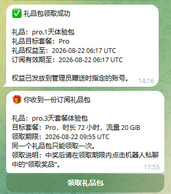
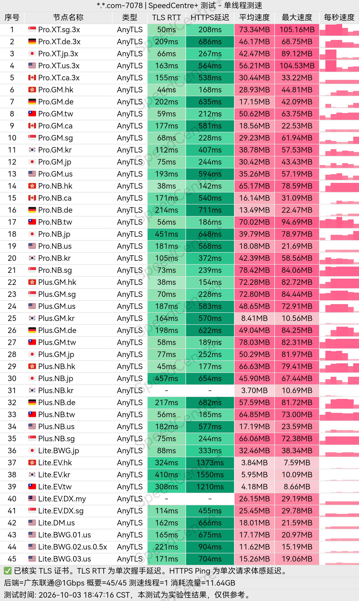
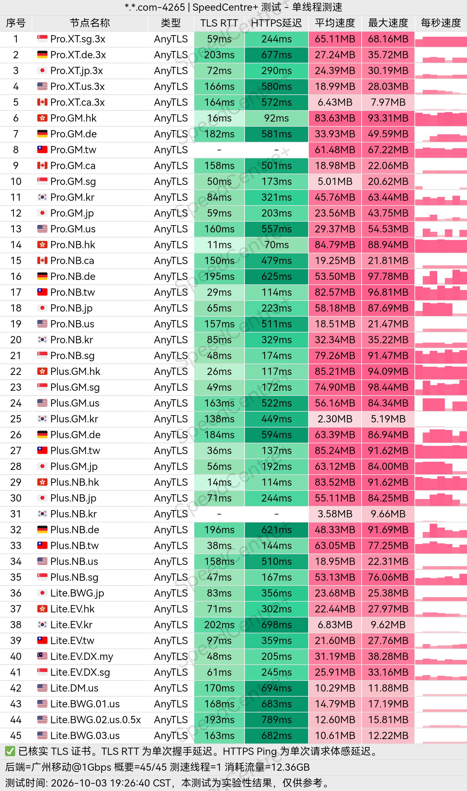
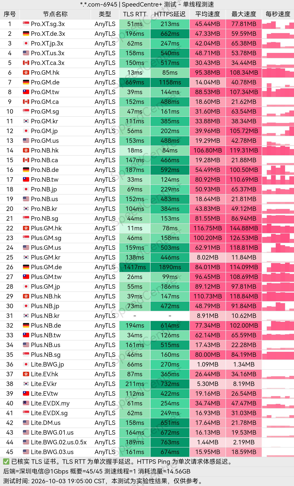
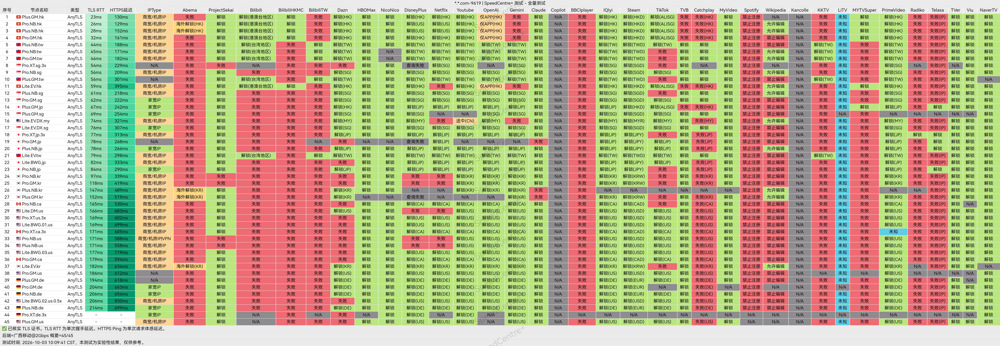
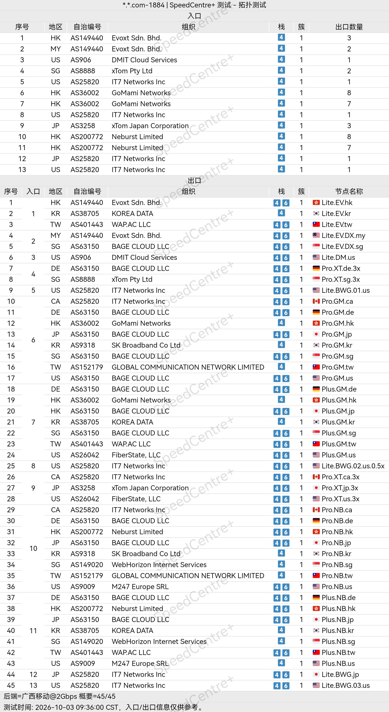

🇨🇳 [中文](README.md) | 🇺🇸 [English](README_EN.md) | 🇷🇺 Русский | 🇮🇷 [فارسی](README_FA.md)

# Официальный сайт Jeeyio VPN (обновлено 2 ноября 2026 года)

Официальный сайт VPN-сервиса Jeeyio<br>
Официальный адрес: [jeeyio.com](https://to.iix.im/jy01)<br>
Telegram-бот для регистрации: [https://t.me/Jeeyio_bot](https://t.me/Jeeyio_bot)<br>

## Пригласительный код

`При регистрации через Telegram-бота необходимо вручную ввести пригласительный код.`<br>

```bash
8HSMGF
```

<br>

## Промокод / Код скидки

`Нет`

## Описание

Jeeyio VPN — прокси-сервис, предназначенный для международного доступа к интернету и поддерживающий современные протоколы, включая VLESS и AnyTLS.

Сервис ориентирован на простоту и практичность, поэтому подходит для повседневного просмотра веб-страниц, использования социальных сетей, потокового видео, учёбы и удалённой работы.

Jeeyio стремится обеспечить пользователям более комфортное и гибкое подключение к зарубежным интернет-ресурсам.

## Преимущества

Главными преимуществами Jeeyio VPN являются поддержка современных протоколов, гибкость настроек и сбалансированное сочетание скорости и стабильности соединения.

Сервис поддерживает протоколы VLESS и AnyTLS и совместим с различными популярными VPN- и прокси-клиентами на нескольких типах устройств.

Удобное управление подключениями и простое переключение между серверами делают Jeeyio подходящим решением для пользователей, которым важны качество сетевых маршрутов, простота использования и совместимость с различными сценариями работы.

## Тарифы и цены

| Название тарифа | Уровень | Цена за месяц | Трафик в месяц | Одновременные IP | Параллельные соединения | Максимальная скорость | Поддержка самостоятельного развёртывания | Основные особенности |
|---|---|---:|---:|---:|---|---|---|---|
| Стандартный тариф · Base | L1 | ¥12.00/месяц | 60 GB | 3 | Без ограничений | Без ограничений | Да | Серверы с низким коэффициентом расхода трафика, поддержание постоянной доступности соединения и основные возможности сервиса |
| Стандартный тариф · Plus | L2 | ¥30.00/месяц | 150 GB | 5 | Без ограничений | Без ограничений | Да | Обеспечивает комфортный просмотр веб-страниц и дополнительные точки входа; по сравнению с Base: +90 GB трафика и +2 одновременных IP |
| Стандартный тариф · Pro | L3 | ¥48.00/месяц | 240 GB | 10 | Без ограничений | Без ограничений | Да | Поддержка разблокировки стриминговых сервисов и стабильного доступа, дополнительные эксклюзивные точки входа; по сравнению с Plus: +90 GB трафика и +5 одновременных IP |

## 📊 Практические тесты производительности и анализ

#### 1.1 Результаты тестирования скорости China Unicom в вечерние часы пик

<br>

#### 1.2 Результаты тестирования скорости China Telecom в вечерние часы пик

<br>

#### 1.3 Результаты тестирования скорости China Mobile в вечерние часы пик

<br>

#### 2. Отчёт о разблокировке стриминговых сервисов

<br>

#### 3. Анализ выходных серверов и входящих сетевых маршрутов

<br>
